<a href="https://pranavjha.in/">portfolio</a> · <a href="https://www.linkedin.com/in/pranav-jha-3000s/">linkedin</a> · <a href="https://pranavjha.in/resume.pdf">resume</a> · <a href="https://github.com/PranavJha-3000">github</a>

