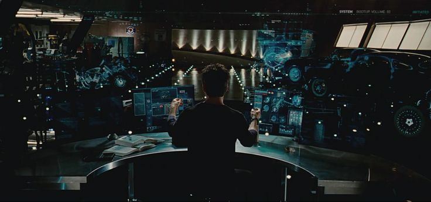
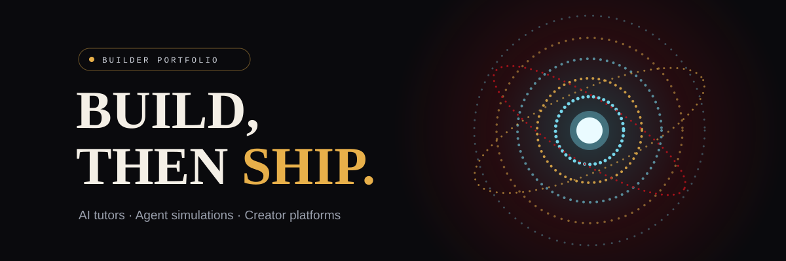
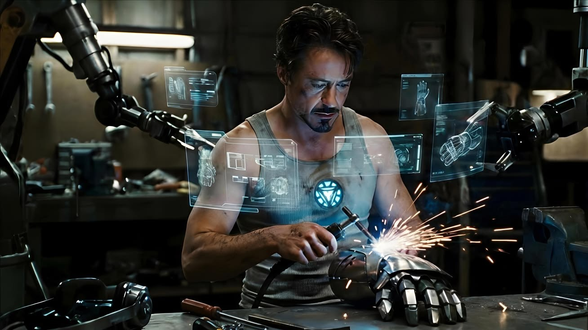

I'm an applied AI engineer finishing a B.Tech in electronics and communication at IIIT Ranchi (2027). I work at the 0-to-1 stage of products: LLM apps, multimodal pipelines, and the backends behind them.

From March to September 2026 I was the founding engineer at UpstageX. Before that I wrote Unreal Engine code for two VR releases and shipped an Android game build. On my own time I build desktop AI tools, agent simulations and career software.

<!-- ABOUT IMAGE (optional): save the generated image as photos/lab.png, then uncomment.

-->

<h2 align="center">WHAT I BUILD</h2>

`APPLIED AI` &nbsp;·&nbsp; `AGENTS` &nbsp;·&nbsp; `PRODUCT`

### UpstageX

I was the founding engineer from March to September 2026. I built a searchable dataset of 1M+ creator profiles, which sped up fit scoring by 40%, and Gemini-backed brief generation on NestJS and GCP, which cut contract time by 60%. The platform grew to 15 brands, 30 creators and ₹500,000+ in campaign value.

### [HeyGanesh](https://github.com/PranavJha-3000/HeyGanesh)

A Windows desktop tutor that can see your screen. Hold Ctrl+Alt, ask out loud, and it points at what you mean and answers with speech, drawn lessons and clickable 3D models. It reads the interface through Windows UI Automation first and falls back to a vision model, which gets it to 95% detection accuracy.

### [Black-Sheep](https://github.com/PranavJha-3000/Black-Sheep)

A simulated market where AI hedge funds trade against each other, built to study how language-model agents behave over long horizons. The engine is deterministic and seeded, the agents' decisions are schema-validated with rule-based fallbacks, and the audited release passes 84 of 84 engine tests.

### [IloveEmployement](https://github.com/PranavJha-3000/IloveEmployement)

Ilovepdf, but for getting a job. Upload a resume as PDF, DOCX or TXT and it checks your evidence against a role, flags the missing qualifications and keywords, and runs interview practice. 50+ people have used it.

<h2 align="center">SKILLS &amp; TOOLING</h2>

<table>
<tr>
<td width="50%" valign="top" align="center">

### AI / GENAI

</td>
<td width="50%" valign="top" align="center">

### LANGUAGES & BACKEND

</td>
</tr>
<tr>
<td width="50%" valign="top" align="center">

### FRONTEND & DATA

</td>
<td width="50%" valign="top" align="center">

### SYSTEMS & TESTING

</td>
</tr>
</table>

<i>Even a suit built in a cave has to be tested in public.</i>

